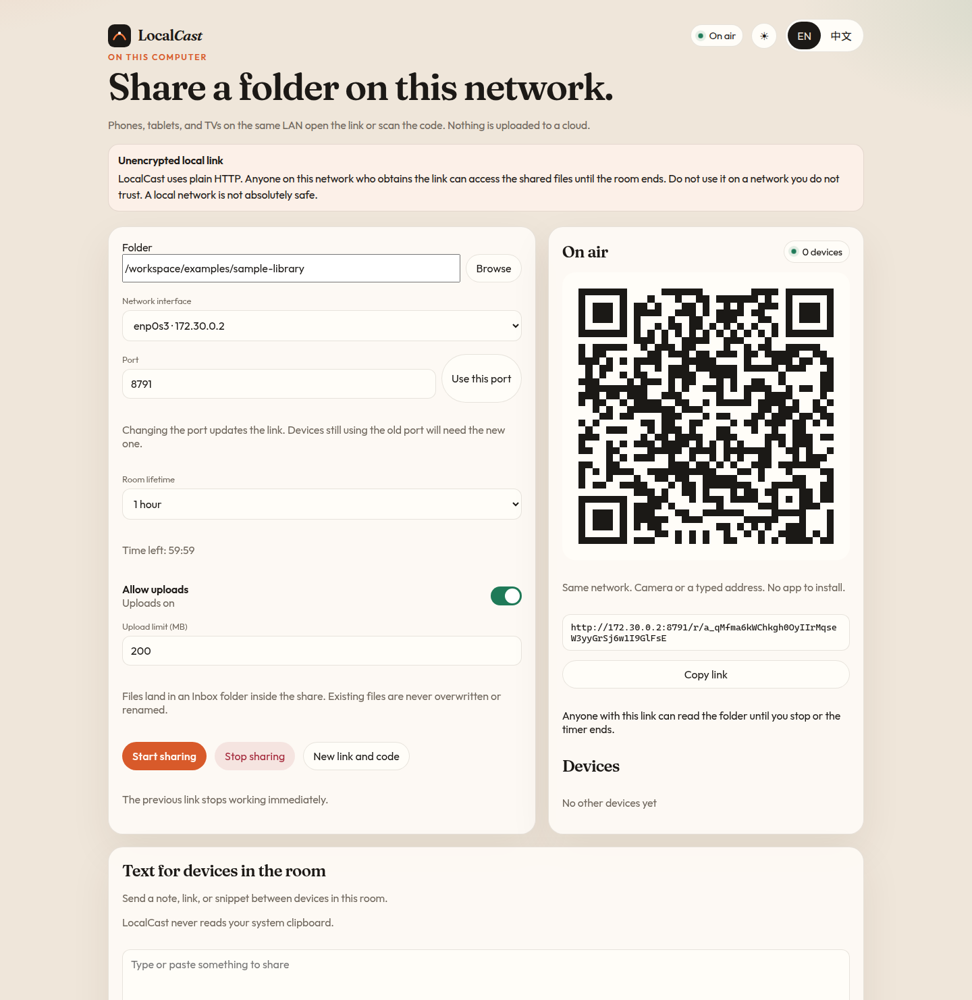
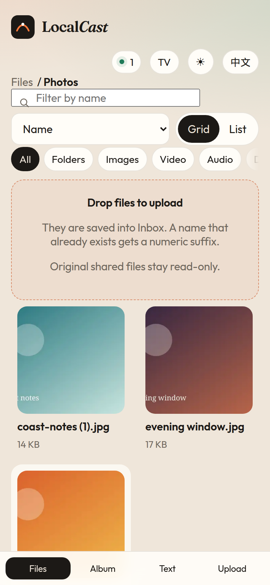
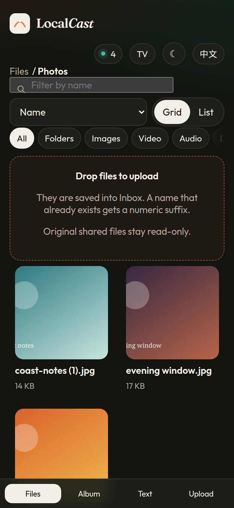
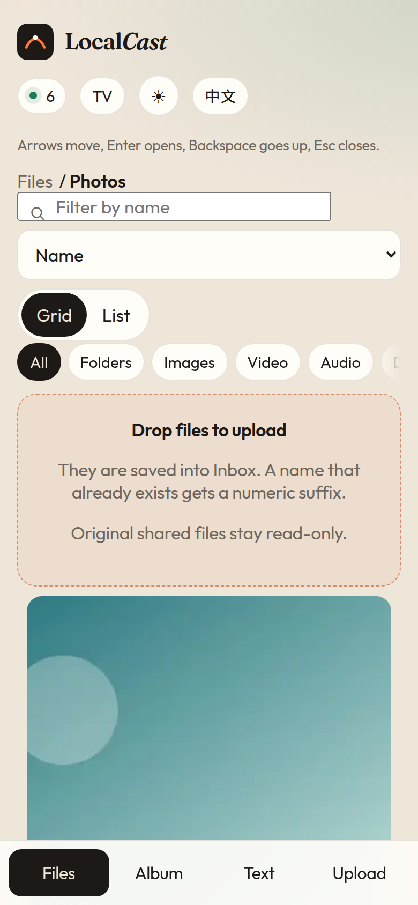

LocalCast — Share a folder. Scan a code. Access anywhere on your local network.

LocalCast turns a folder on your computer into a temporary page for phones, tablets, and TVs on the same local network. There is no account, no mobile app, and no upload to a cloud host. It is not affiliated with LocalSend or PairDrop.

Anyone who has the link can read the shared files until you stop the room or it expires. The link is plain HTTP. A local network is not absolutely safe. Read [Security](#security) before using it.









The address in the screenshots belonged to a demo room that was already stopped. It will not open anything.

## Install and run

Node.js 20 or newer.

```bash
npm install
npm run build
npm start
```

Open the admin page printed in the terminal, usually `http://127.0.0.1:8787/`. Choose a folder there. The guest link and QR code stay on that page. They are not written to the log line.

Share a folder immediately:

```bash
npm start -- share ./examples/sample-library --ttl 1h --upload
```

Useful flags:

| Flag | Meaning |
| --- | --- |
| `--port 8787` | TCP port |
| `--bind 0.0.0.0` | Listen address. `127.0.0.1` keeps it on this computer |
| `--advertise 192.168.1.20` | IPv4 address placed in the QR code |
| `--ttl 15m` | `15m`, `1h`, or `unlimited` |
| `--upload` | Allow uploads into `Inbox` |
| `--max-upload 200MB` | Per-file upload cap |
| `--open` | Open the admin page in a browser |

`npm run localcast` is the same program without a build step. Copy `.env.example` to `.env` if you want defaults. Flags override the file.

Your firewall may ask before other devices can connect. Allow the port on private networks only.

## What you can do

From the computer:

- Pick a folder, a network interface, and a port.
- Show a large QR code and copy the link.
- See how many devices are connected.
- Set the room to 15 minutes, 1 hour, or until you stop it.
- Turn uploads on or off. Uploaded files go to `Inbox` inside the share. Names that already exist get a numeric suffix. Original files are not overwritten, renamed, or deleted.
- Stop the room. Old links fail immediately.
- Replace the link and QR code. The previous token stops working.
- Send a text note to devices in the room. LocalCast never reads the system clipboard.

From a browser on another device:

- Walk folders with breadcrumbs, search, sort, and filters.
- Switch between a thumbnail grid and a list.
- Preview images, play browser-friendly video and audio, and preview PDFs.
- Download files, including names with Chinese, spaces, and symbols.
- Seek supported video with HTTP Range requests.
- Open an album: grid, full-screen, swipe, slideshow, cached thumbnails.
- See an explicit message when a video or audio format is not supported. LocalCast does not transcode.
- Drag and drop uploads when the computer has allowed them, with a progress bar.
- Share text back to the computer.
- Turn on TV mode: larger type, and arrow keys to move between items.

## Sample library

`examples/sample-library` has photos, a short WAV, a PDF, and file names with Chinese, spaces, and symbols. Regenerate it with `npm run samples` after `npm install`.

## Security

LocalCast is a convenience tool for a network you control.

- Only the folder you selected can be read. The filesystem root and a whole drive root are refused.
- Paths are checked before and after symlink resolution. A link that points outside the folder is hidden and cannot be downloaded.
- Every guest request needs the random session token. Guessing it is not practical.
- Admin controls accept connections only from loopback, and only when the `Host` is `localhost` or `127.0.0.1`. Cross-site posts are rejected.
- A remote browser cannot choose a server path. Uploads are stored under `Inbox` using a cleaned file name.
- HTML, SVG, and script files are downloaded as opaque bytes so they do not run inside the LocalCast origin.
- Tokens are not written to the server log. The terminal prints the admin URL only.
- There is no public tunnel and no third-party file host.
- Traffic is not encrypted. Anyone on the network who obtains the link can read the files until the room ends. Do not use LocalCast on a network you do not trust. This does not make a LAN absolutely safe.

## Devices that are not on the same LAN

Not implemented.

A pairing code for two devices on different networks would need a way to exchange connection details. Sending the files through a public server would break the rule against third-party hosting and default public exposure. An optional WebRTC mode could avoid that only if all of the following stay true:

- It is off unless the person at the computer turns it on for that room.
- Signaling is a server you run yourself. The public internet is not used as a default meeting point.
- The signaling server forwards connection messages only, never file bytes.
- There is no TURN relay unless you configure your own. Without it, many NATs will simply fail to connect.
- The pairing code is as unguessable as the room token, expires with the room, and is never logged.
- The same folder, token, and upload rules still apply after the peers connect.

That design is not built here. A half-finished relay would be less safe than leaving the feature out.

## Tests and platforms

`npm test` runs the automated checks on this machine. The latest local run, Node.js v22.23.4 on Linux x64, reported 24 passing tests and 0 failures. That run covered:

1. Homepage and the plain-HTTP warning
2. Folder listing and download
3. Chinese, space, and symbol file names
4. Image, audio, video, and PDF responses, including an honest unsupported-format flag
5. HTTP Range on a 5 MiB file, including a middle slice, a suffix, and an unsatisfiable range
6. 24 overlapping reads
7. A streamed upload whose received-byte count was observed before completion, plus no-overwrite behavior
8. Path traversal and symlink escapes, including an `Inbox` symlink that points outside the share
9. 15-minute expiry, 1-hour expiry, unlimited lifetime, room close, and token regeneration

Windows and macOS were not executed here. GitHub Actions is set up to run the same `npm test` and `npm run build` on `ubuntu-latest`, `windows-latest`, and `macos-latest`. Until that workflow has gone green on those runners, those systems are unverified. Symlink creation can skip on Windows when the OS denies it; the lexical traversal checks still run.

## Development

```bash
npm install
npm test
npm run dev:web   # Vite on 127.0.0.1:5173, proxying /api to port 8787
```

See [CONTRIBUTING.md](CONTRIBUTING.md). Simplified Chinese documentation is in [README.zh-CN.md](README.zh-CN.md).

## License

MIT for LocalCast's own code. See [LICENSE](LICENSE) and [NOTICE](NOTICE). `sharp` is Apache-2.0 and loads a prebuilt libvips whose package metadata is LGPL-3.0-or-later. The bundled Fraunces and Outfit fonts are OFL-1.1.
