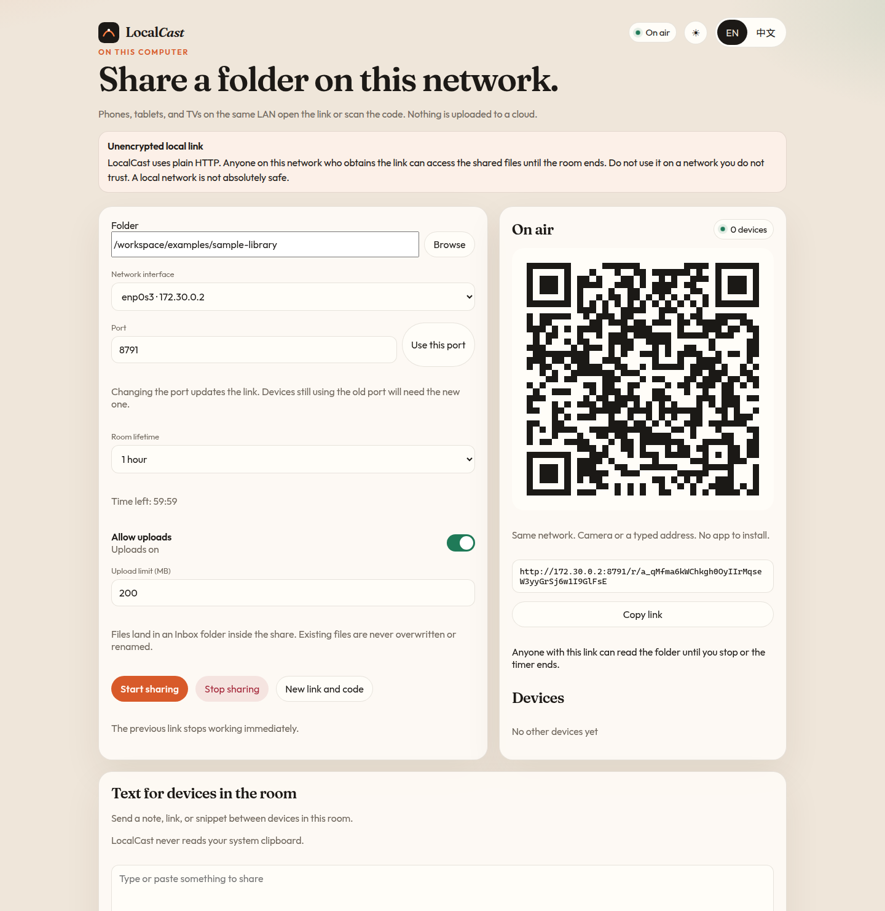
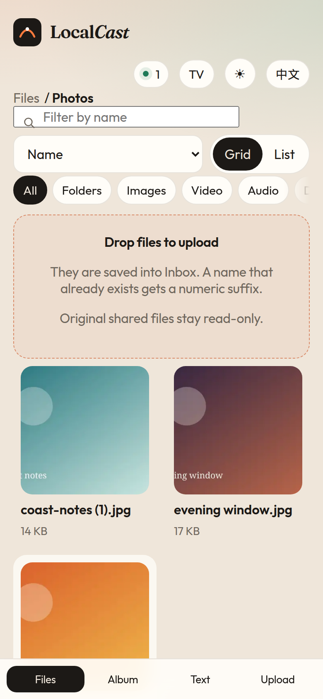
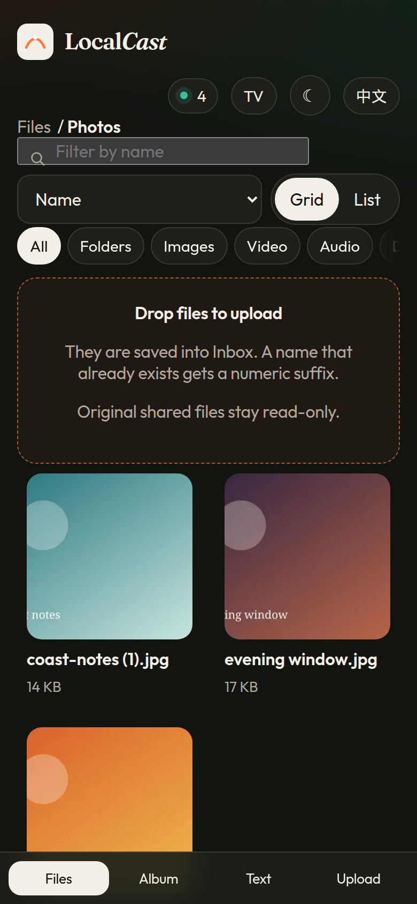
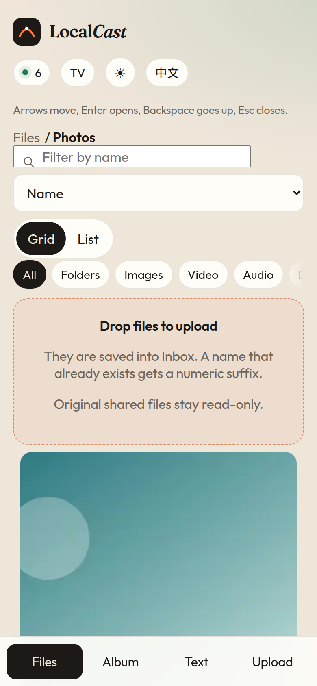

LocalCast — Share a folder. Scan a code. Access anywhere on your local network.

LocalCast 把电脑上的一个文件夹变成局域网里的临时网页。手机、平板和电视用浏览器打开即可，不需要账号，不需要安装客户端，也不会把文件上传到云端。它与 LocalSend、PairDrop 没有关联。

拿到链接的人在房间结束前都能阅读这些文件。链接是未加密的 HTTP。局域网并不绝对安全。使用前请阅读[安全说明](#安全说明)。









截图里的地址来自一次已经停止的演示房间，不能再打开任何内容。

## 安装与启动

需要 Node.js 20 或更新版本。

```bash
npm install
npm run build
npm start
```

在终端打印的管理页打开，通常是 `http://127.0.0.1:8787/`。在那一页选择文件夹。访客链接和二维码只出现在管理页上，不会写进日志。

也可以启动时直接分享：

```bash
npm start -- share ./examples/sample-library --ttl 1h --upload
```

常用参数：

| 参数 | 含义 |
| --- | --- |
| `--port 8787` | 端口 |
| `--bind 0.0.0.0` | 监听地址。`127.0.0.1` 表示只在这台电脑上 |
| `--advertise 192.168.1.20` | 放进二维码的 IPv4 地址 |
| `--ttl 15m` | `15m`、`1h` 或 `unlimited` |
| `--upload` | 允许上传到 `Inbox` |
| `--max-upload 200MB` | 单个文件的大小上限 |
| `--open` | 用浏览器打开管理页 |

`npm run localcast` 不经过构建，直接运行 TypeScript。可以把 `.env.example` 复制为 `.env`。命令行参数优先于环境变量。

系统防火墙可能会询问是否允许连接。请只在专用网络上放行该端口。

## 可以做什么

在电脑上：

- 选择文件夹、网卡和端口。
- 显示大号二维码并复制链接。
- 查看当前连接的设备数量。
- 把房间设为 15 分钟、1 小时，或直到你手动停止。
- 打开或关闭上传。上传的文件进入共享目录里的 `Inbox`。同名文件会加上序号，不会覆盖。原始文件不能被远程删除、重命名或修改。
- 停止房间。旧链接立刻失效。
- 重新生成链接和二维码。旧令牌立即失效。
- 给房间里的设备发一段文字。LocalCast 不会读取系统剪贴板。

在其他设备的浏览器里：

- 用面包屑浏览文件夹，并搜索、排序、筛选。
- 在缩略图网格和列表之间切换。
- 预览图片，播放浏览器支持的视频和音频，预览 PDF。
- 下载文件，包括中文、空格和符号文件名。
- 对支持的视频使用 HTTP Range 拖动进度。
- 相册模式：网格、全屏、滑动、幻灯片，以及缓存的缩略图。
- 遇到浏览器不能播放的格式时给出明确说明。LocalCast 不会转码。
- 在电脑允许上传时拖放文件，并显示进度。
- 把文字发回电脑。
- 电视模式：更大的字号，方向键在项目之间移动。

## 示例文件夹

`examples/sample-library` 里有照片、一段短 WAV、一份 PDF，以及带中文、空格和符号的文件名。安装依赖后可以运行 `npm run samples` 重新生成。

## 安全说明

LocalCast 适合在你自己控制的网络里临时使用。

- 只能读取你选中的文件夹。程序会拒绝把整块磁盘或文件系统根目录分享出去。
- 路径在解析符号链接之前和之后都会检查。指向共享目录之外的链接不会出现在列表里，也不能下载。
- 每次访问都需要随机会话令牌。
- 管理接口只接受本机回环连接，并且 `Host` 必须是 `localhost` 或 `127.0.0.1`。跨站提交会被拒绝。
- 远程浏览器不能指定服务器上的路径。上传只写入 `Inbox`，文件名会先清理。
- HTML、SVG 和脚本会按不可执行的字节下载，避免在 LocalCast 的页面来源里运行。
- 令牌不会写入服务器日志。终端只打印管理页地址。
- 默认没有公网穿透，也不使用第三方文件托管。
- 流量不加密。同一网络中，任何拿到链接的人都能在房间结束前阅读文件。不要在不可信的网络上使用。这并不能使局域网绝对安全。

## 不在同一局域网的设备

尚未实现。

如果两台设备不在同一个网络，配对码需要某种方式交换连接信息。把文件交给公共服务器转发，会违反「不使用第三方托管、默认不暴露到公网」的要求。可选的 WebRTC 模式只有在下面全部成立时才值得做：

- 默认关闭，必须由电脑前的人显式打开。
- 信令服务器由你自己部署，不把公共互联网当成默认的会合点。
- 信令服务器只转发连接消息，不转发文件内容。
- 除非你自己配置 TURN，否则不使用中继。没有中继时，很多网络会直接连不上。
- 配对码与房间令牌一样不可猜测，随房间过期，并且不写入日志。
- 连接建立之后，仍然使用同一套目录限制、令牌和上传规则。

这里没有实现这个设计。一个不完整的中继比不做更不安全。

## 测试与平台

在这台机器上运行 `npm test`。最近一次本地结果是 Node.js v22.23.4、Linux x64：24 项通过，0 项失败。覆盖：

1. 首页，以及明文 HTTP 警告
2. 文件夹列表与下载
3. 中文、空格和特殊字符文件名
4. 图片、音频、视频、PDF 响应，以及对不支持格式的明确标记
5. 5 MiB 文件的 HTTP Range，包括中间片段、尾部片段和无法满足的范围
6. 24 个重叠读取
7. 上传过程中观察到已接收字节数增长，以及禁止覆盖
8. 路径穿越和符号链接越界，包括把 `Inbox` 指到目录外的符号链接
9. 15 分钟过期、1 小时过期、不限时、关闭房间、重新生成令牌

同一套 `npm test` 和 `npm run build` 也会在 GitHub Actions 的 `ubuntu-latest`、`windows-latest` 和 `macos-latest` 上运行。当前分支上这三个任务都已通过。Windows 若不允许创建符号链接，相关测试会跳过；词法层面的穿越检查仍会运行。没有用真实手机连过 Wi-Fi；手机截图是 Chrome 在 375px 和 390px 宽度下拍的。

## 开发

```bash
npm install
npm test
npm run dev:web
```

参与方式见 [CONTRIBUTING.md](CONTRIBUTING.md)。英文说明见 [README.md](README.md)。

## 许可证

LocalCast 自己的代码使用 MIT 许可证。详见 [LICENSE](LICENSE) 和 [NOTICE](NOTICE)。`sharp` 是 Apache-2.0，它加载的预编译 libvips 包元数据为 LGPL-3.0-or-later。打包进去的 Fraunces 与 Outfit 字体是 OFL-1.1。
